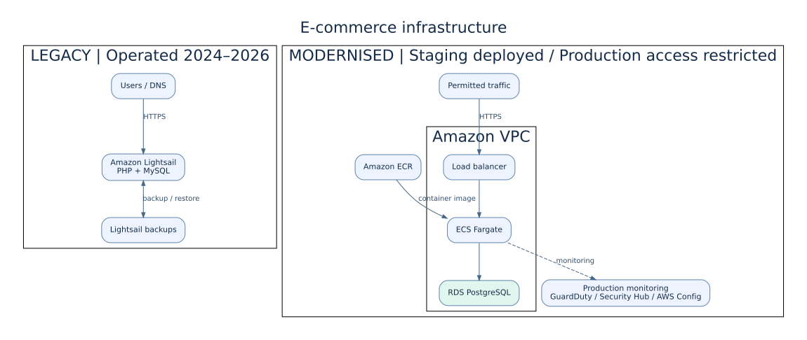

# Cloud E-commerce Infrastructure Modernisation

## Executive overview

I owned the e-commerce infrastructure from 2024 through November 2026. Staging was deployed in October 2026. The new production infrastructure was built in November 2026 and access remained restricted pending public launch.

## Business challenge

The existing PHP and MySQL platform needed reliable hosting and recovery, alongside a route to modern infrastructure.

## Solution architecture

The legacy application and MySQL database ran on Amazon Lightsail. The modernised design routes traffic through a load balancer to ECS Fargate in a VPC. Containers come from ECR, and the application uses RDS for PostgreSQL.

## Technical implementation

I configured HTTPS, backups, DNS and application hosting on Lightsail and recovered the infrastructure after an instance failure. I provisioned the modern infrastructure with Terraform and completed a successful backup restoration test.

## Personal responsibilities

I owned infrastructure delivery, audited the legacy environment and assessed integration with an external inventory system. Application development was handled separately. The AI layer was outside the implementation scope.

## Security and governance

I implemented production monitoring, GuardDuty, Security Hub and AWS Config. Production access remained restricted at the point documented here.

## Cost optimisation

The audit identified cross-region inefficiencies. Architecture optimisation reduced projected monthly launch infrastructure costs by approximately 26%.

## Project outcomes

The legacy infrastructure was recovered, staging was deployed, production infrastructure was built and a backup was successfully restored. Public launch remained pending.

## Architecture diagram

[Editable Graphviz source](../diagrams/project-1-architecture.dot)

## Technologies used

Amazon Lightsail, PHP, MySQL, Terraform, Amazon ECS on Fargate, Amazon ECR, Amazon VPC, load balancing, Amazon RDS for PostgreSQL, GuardDuty, Security Hub and AWS Config.

## Lessons learned

Run restoration checks before launch and use the legacy audit to identify avoidable costs in the replacement design.
