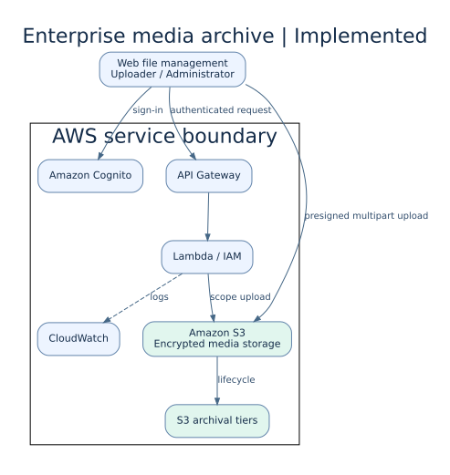

# Enterprise Media Archive

## Executive overview

I architected a serverless media archive for a media production organisation and collaborated with the delivery team on its implementation. During its operational lifecycle, the archive approached 20 TB of stored media, based on my project experience.

## Business challenge

Large media files called for reliable transfers and long-term retention, with distinct permissions for uploaders and administrators.

## Solution architecture

A web interface uses Cognito for authentication and API Gateway and Lambda for upload coordination. Media files travel directly from the browser to Amazon S3.

## Technical implementation

The archive uses short-lived presigned URLs for direct browser-to-S3 multipart uploads. API Gateway invokes Lambda to authorise and coordinate upload initiation, part signing and completion; the media bytes do not transit Lambda or API Gateway. Parallel part transfers, retrying individual parts and handling interrupted uploads were design considerations. The web interface supports file management.

## Personal responsibilities

I owned the solution architecture, including ingestion, access and storage lifecycle design, and contributed to implementation as part of the delivery team.

## Security and governance

The design uses encryption and least-privilege IAM. Uploader and administrator roles scope file operations, and CloudWatch supports operational visibility.

## Cost optimisation

Amazon S3 Lifecycle rules transition eligible objects to archival storage classes; EventBridge is not required for ordinary lifecycle transitions. S3 storage is chargeable, and tier selection needs to account for request and retrieval costs.

## Project outcomes

The archive was implemented and used by the media production team, reaching nearly 20 TB of stored media before the engagement ended. The figures represent historical usage, not current operational capacity. Measured transfer performance and realised savings are unverified.

## Architecture diagram

[Editable Graphviz source](../diagrams/project-2-architecture.dot)

## Technologies used

Amazon S3, AWS Lambda, Amazon API Gateway, Amazon Cognito, AWS IAM and Amazon CloudWatch.

## Lessons learned

Separate upload coordination from file transfer and plan recovery at the part level for large uploads.
