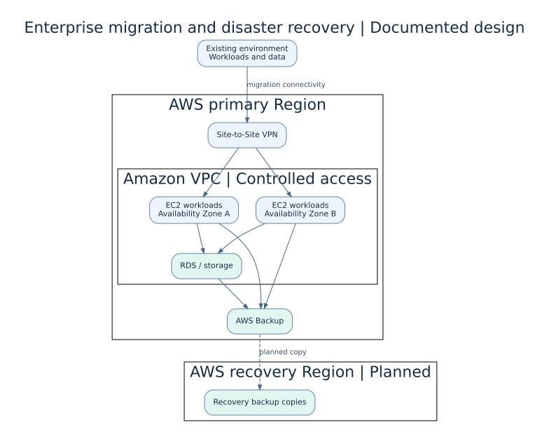

# Enterprise Cloud Migration & Disaster Recovery

## Executive overview

The professional CV reports an enterprise migration engagement involving 1.5 TB of data and six virtual machines. This case study documents the architecture and planning work.

## Business challenge

The engagement required an assessment of existing workloads, dependencies and storage, with a plan for availability and recovery in AWS.

## Solution architecture

The design connects the existing environment to an AWS VPC. Workloads span availability zones in the high-availability design. Backup retention and a cross-region recovery path form part of the disaster recovery design.

## Technical implementation

Technical work covered discovery, workload assessment, migration sequencing, networking, security, storage and backup and recovery planning. Deployment evidence for individual design components is incomplete.

## Personal responsibilities

I contributed to discovery, cloud architecture and migration planning, including workload and recovery requirements.

## Security and governance

The design called for controlled connectivity, access controls and network boundaries around workloads and storage.

## Cost optimisation

The design considered sizing workloads to demand and using storage lifecycle policies to manage retention costs.

## Project outcomes

The engagement produced a documented migration, high-availability and disaster recovery design. Recovery time and recovery point objectives guided planning. Measured recovery results and cross-region failover tests are unverified.

## Architecture diagram

[Editable Graphviz source](../diagrams/project-3-architecture.dot)

## Technologies used

Amazon VPC, Amazon EC2, Amazon RDS, AWS Site-to-Site VPN and AWS Backup in the documented design.

## Lessons learned

Record recovery objectives separately from test results and verify component-level deployment before reporting migration outcomes.
