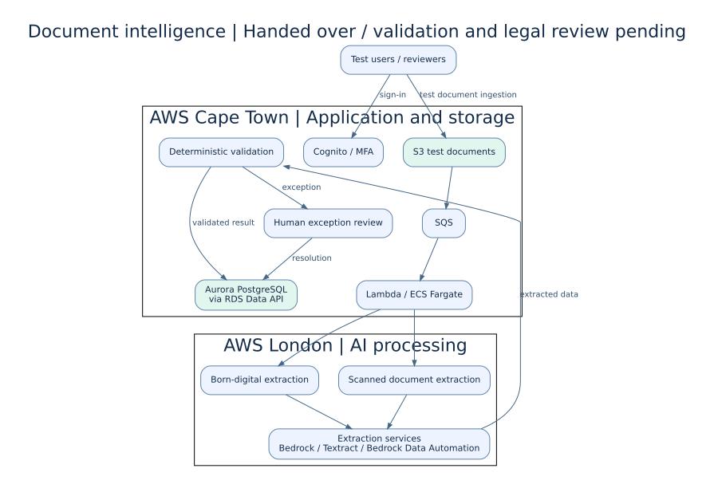

# AI-Powered Document Intelligence Platform

## Executive overview

The platform was handed over in November 2026. Final end-to-end validation and legal review were pending. Use was limited to synthetic or test data until de-identification controls could be validated.

## Business challenge

The workflow needed to process both born-digital and scanned documents while giving reviewers a way to resolve exceptions.

## Solution architecture

Cape Town hosts the application and storage infrastructure. AI processing uses London. Amazon S3 receives documents, and SQS, Lambda and ECS Fargate coordinate processing. Separate extraction paths handle born-digital and scanned documents.

## Technical implementation

The platform uses Amazon Bedrock, Textract and Bedrock Data Automation for extraction. Deterministic validation checks extracted data before exceptions go to human review. Aurora Serverless v2 for PostgreSQL stores application data through the RDS Data API.

## Personal responsibilities

I led the cloud architecture, security and compliance assessment and cost work across five architecture iterations.

## Security and governance

Cognito provides authentication and MFA. CloudFormation defines infrastructure and cfn-guard validates templates. Cross-region processing and de-identification were relevant to the pending legal review.

## Cost optimisation

Removing six unnecessary VPC endpoints reduced estimated recurring infrastructure costs by approximately USD 87 per month.

## Project outcomes

The AWS partner funding application was approved and the platform was handed over. Final validation and legal review remained open at handover.

## Architecture diagram

The diagram separates authentication from document ingestion: Cognito authenticates users, but does not itself grant S3 access. The ingestion authorization mechanism is not evidenced here. Cross-region extraction arrows represent logical processing; they do not establish that de-identification or legal approval was completed.

[Editable Graphviz source](../diagrams/project-4-architecture.dot)

## Technologies used

Amazon S3, SQS, Lambda, ECS Fargate, Bedrock, Textract, Bedrock Data Automation, Aurora Serverless v2 PostgreSQL, RDS Data API, Cognito, CloudFormation and cfn-guard.

## Lessons learned

Separate extraction, deterministic validation and exception review so each step can be evaluated on its own.
