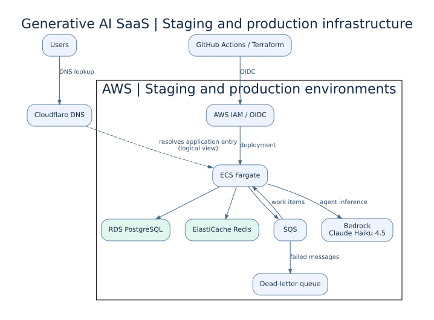

# Generative AI SaaS Infrastructure

## Executive overview

I led infrastructure engineering for an AI-powered SaaS platform. Hosting evolved from EC2 through managed application hosting to an AWS architecture.

## Business challenge

The platform needed repeatable infrastructure for staging and production, a managed database and a way to evaluate AI providers.

## Solution architecture

Terraform manages AWS infrastructure. ECS Fargate runs application workloads with RDS for PostgreSQL and ElastiCache for Redis. SQS supports asynchronous work, with dead-letter queues for failed messages.

## Technical implementation

I migrated the externally hosted PostgreSQL database to Amazon RDS and moved an AI agent to Amazon Bedrock using a Claude Haiku model. GitHub Actions uses OIDC to assume a scoped AWS IAM role for CI/CD without storing long-lived AWS access keys in GitHub. Terraform and deployment tooling perform infrastructure and service updates using those temporary credentials; IAM itself is not a deployment engine. Cloudflare manages DNS.

## Personal responsibilities

I led infrastructure design, migration, monitoring and technical review. Application development was handled separately.

## Security and governance

I conducted AWS Well-Architected and infrastructure security reviews. External or global AI inference can involve cross-border processing.

## Cost optimisation

The work included prompt caching and an AI provider comparison. Realised cost savings are unverified.

## Project outcomes

Production and staging were established, and the database and AI agent migrations were completed.

## Architecture diagram

DNS arrows show name resolution, not an application request path. The application ingress component is intentionally unspecified and should not be interpreted as direct public exposure of ECS tasks. The diagram is a logical service-dependency view, not a deployable network or security-group configuration. GitHub Actions obtains short-lived AWS credentials through OIDC; Terraform and deployment tooling perform changes rather than IAM itself deploying ECS workloads.

[Editable Graphviz source](../diagrams/project-5-architecture.dot)

## Technologies used

Terraform, Amazon EC2, ECS Fargate, RDS for PostgreSQL, ElastiCache for Redis, SQS, Amazon Bedrock, Claude Haiku 4.5, GitHub Actions OIDC and Cloudflare DNS.

## Lessons learned

Track the hosting, database and inference boundaries independently when planning a platform migration.
