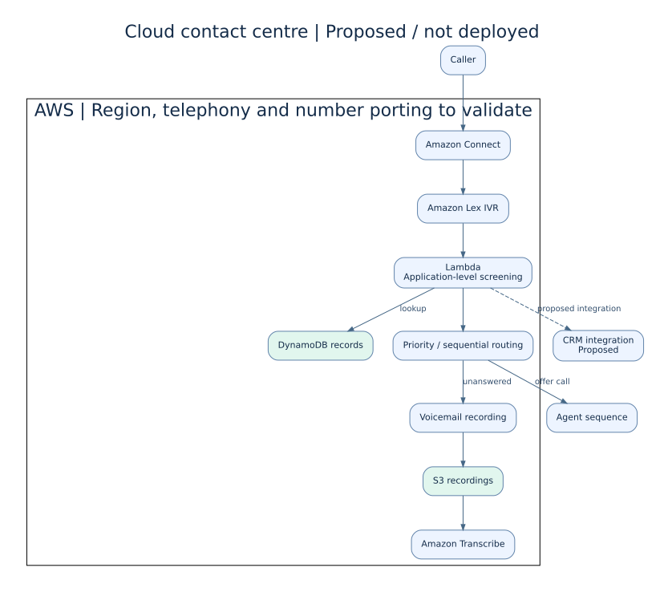

# Intelligent Cloud Contact Centre

## Executive overview

This pre-sales engagement produced a proposed cloud contact centre architecture. The opportunity closed before infrastructure was deployed.

## Business challenge

The contact centre needed to qualify incoming leads, prioritise calls and reach an available agent, with voicemail for unanswered calls.

## Solution architecture

The proposed design uses Amazon Connect and a Lex IVR. Application-level screening and lead qualification feed priority rules and sequential agent routing. The voicemail path includes recording and transcription.

## Technical implementation

The design uses Lambda for routing and screening logic, DynamoDB for supporting records, and S3 and Amazon Transcribe for voicemail. CRM integration was proposed.

## Personal responsibilities

I carried out technical discovery and produced the architecture, AWS cost model and phased delivery plan.

## Security and governance

Regional service availability, telephony support and number porting require validation before delivery. Voicemail handling also requires review of access and retention.

## Cost optimisation

The cost model informed phased delivery planning. Pricing would need fresh validation before procurement.

## Project outcomes

The engagement produced a proposal and delivery plan. No infrastructure was deployed.

## Architecture diagram

[Editable Graphviz source](../diagrams/project-6-architecture.dot)

## Technologies used

Amazon Connect, Amazon Lex, AWS Lambda, Amazon DynamoDB, Amazon S3 and Amazon Transcribe in the proposed design.

## Lessons learned

Validate telephony prerequisites before finalising the routing design and schedule.
