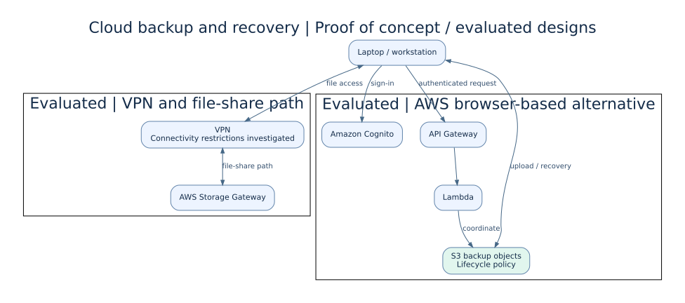

# Cloud Backup & Recovery

## Executive overview

The proof of concept successfully demonstrated file backup and restoration for laptops and workstations.

## Business challenge

Network restrictions affected file-share connectivity. The evaluation explored how users could securely upload files and retrieve them during recovery.

## Solution architecture

One option evaluated AWS Storage Gateway with VPN connectivity. A browser-based alternative used Cognito for authentication, API Gateway and Lambda for coordination, and S3 for storage.

## Technical implementation

I investigated network restrictions on the file-share path and evaluated secure upload and recovery flows for the browser alternative. The case study documents the evaluated designs.

## Personal responsibilities

I assessed connectivity, storage, access controls and recovery considerations for both options.

## Security and governance

Both options required controlled access. The browser design used authenticated access to govern file operations, while the file-share option depended on the VPN and network configuration.

## Cost optimisation

Storage lifecycle and retention were part of the evaluation. Recovery needs inform storage class selection and retrieval costs.

## Project outcomes

The proof of concept successfully demonstrated backup and file restoration, identified connectivity constraints and documented an alternative browser design. Enterprise rollout and measured recovery performance are unverified.

## Architecture diagram

[Editable Graphviz source](../diagrams/project-7-architecture.dot)

## Technologies used

AWS Storage Gateway, VPN connectivity, Amazon S3, Amazon Cognito, Amazon API Gateway and AWS Lambda in the evaluated options.

## Lessons learned

Test connectivity and recovery from the user device before selecting the backup approach.
